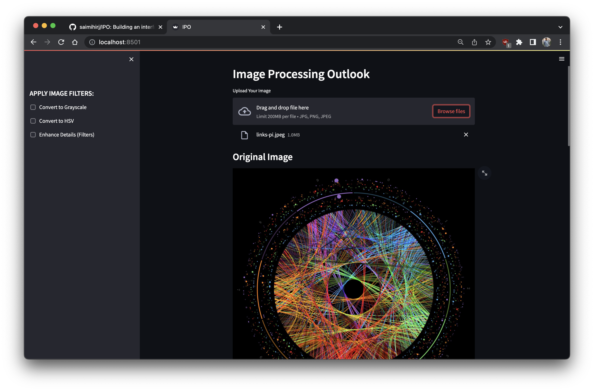
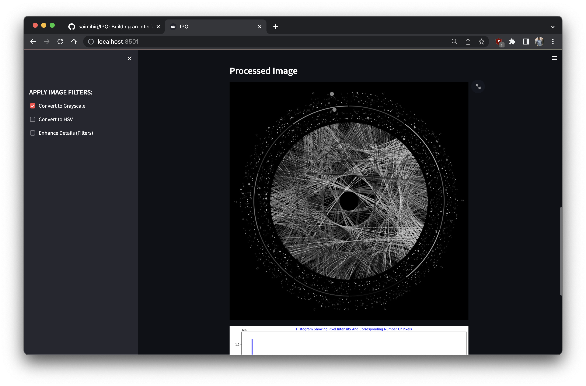
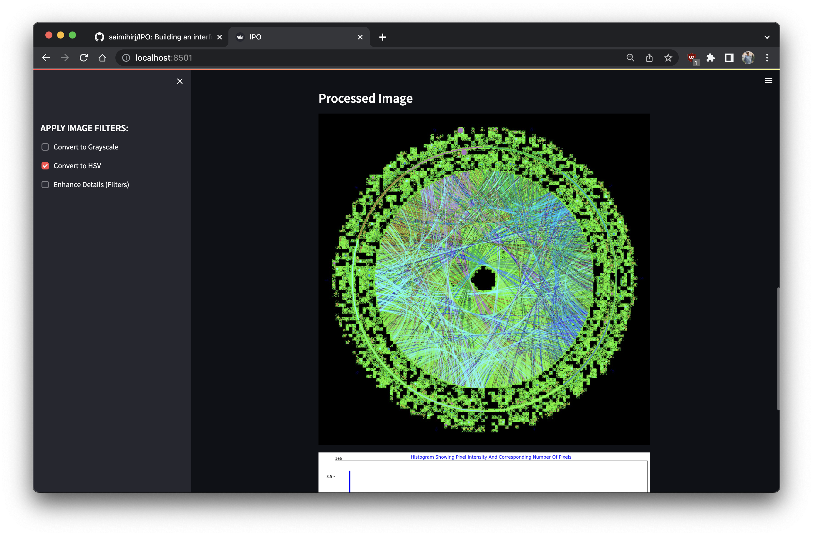
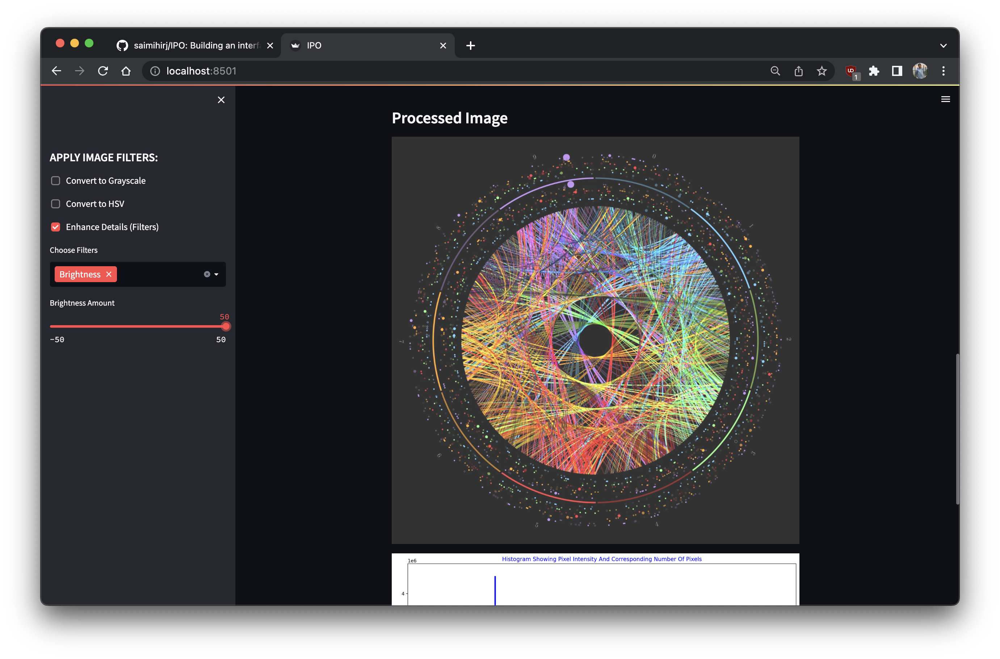
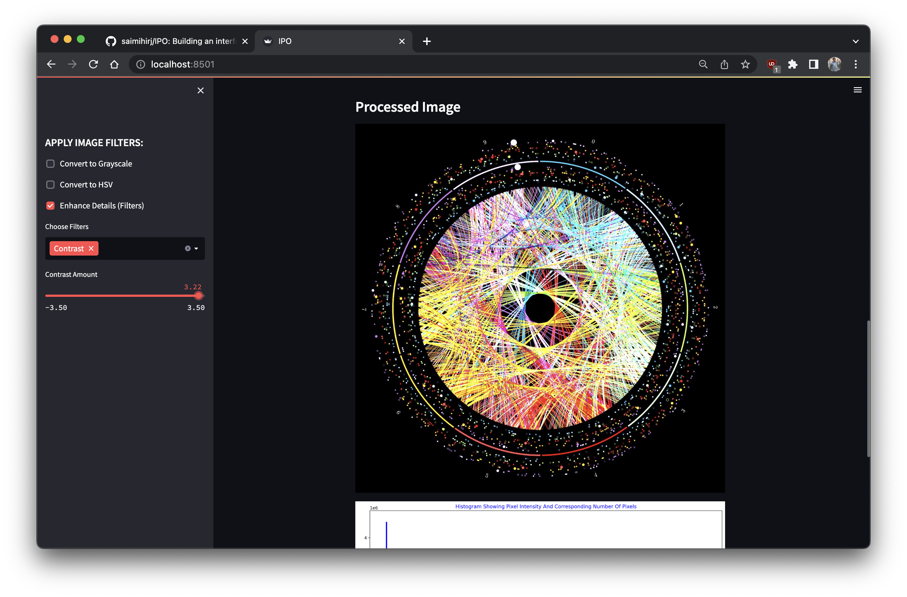
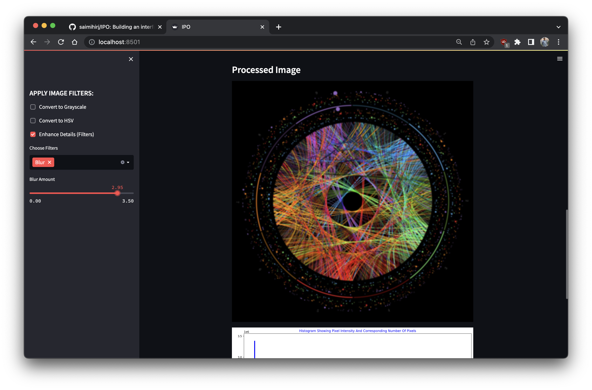

# Image Processing Outlook

A Streamlit app for exploring basic image processing. Upload a JPG or PNG, apply filters from the side panel, and compare the original with the processed image, each shown with a histogram of its pixel intensities.

## Filters

| Filter | What it does |
|---|---|
| Grayscale | Converts the image to a single luminance channel |
| HSV | Converts the image to the hue, saturation and value colour model |
| Blur | Gaussian blur with an adjustable strength |
| Brightness | Shifts every pixel value up or down |
| Contrast | Scales pixel values to stretch or compress the range |

Filters are applied in that order and build on each other, so you can, for example, blur a grayscale image. Image processing uses OpenCV; the histograms use Matplotlib.

## Running it

Requires Python 3.11 or later.

```bash
pip install -r requirements.txt
streamlit run app.py
```

## Screenshots

| Upload | Grayscale | HSV |
|---|---|---|
|  |  |  |

| Brightness | Contrast | Blur |
|---|---|---|
|  |  |  |

## License

MIT. See [LICENSE](LICENSE).
